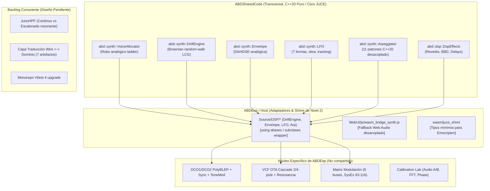

# Estado Actual del Sustrato Compartido: ABDSharedCode, Shims y Fronteras de Host

> **Fecha:** Octubre 2026  
> **Alcance:** Auditoría arquitectónica y cierre de sustrato post-Fase 0/Nivel 2.  
> **Estado de Verificación:**  
> • C++: 160 suites, 1.119.736 aserciones, 0 fallos (`ABDEep_UnitTests.exe`).  
> • WebUI: 124 suites, 5.084 tests, 0 fallos (`npm test` vía Vitest).

---

## 1. Propósito y Filosofía del Sustrato

Este documento consolida y delimita la arquitectura modular entre **ABDEep** (el sintetizador anfitrión y laboratorio de calibración del Behringer DeepMind 12) y **ABDSharedCode** (la biblioteca compartida transversal del ecosistema ABDSynths, compartida con proyectos como *ABDJUNiO601* y *ABDStereoChorus*).

Su objetivo es evitar la reintegración inadvertida de código ya promovido, definir el perfil técnico de cada *shim* de compatibilidad, y formalizar qué piezas pertenecen al host y cuáles permanecen conscientemente en el backlog de diseño.



---

## 2. Inventario de Componentes Promovidos

### 2.1 Módulo `SynthCore` (`namespace abd::synth`)
Todos los componentes promovidos a `SynthCore` cumplen estrictamente con las reglas:
- **C++20 estándar puro**: Solo librerías estándar (`<cstdint>`, `<cmath>`, `<algorithm>`, `<array>`, `<concepts>`).
- **Cero dependencias de JUCE** y cero dependencias de asignación dinámica de memoria en tiempo de audio (*Zero-alloc RT-safe*).
- **Invarianza de frecuencia de muestreo**: Los coeficientes y tasas de integración se recalculan explícitamente en `prepare(sampleRate)`.

| Componente | Archivos en `ABDSharedCode` | Funcionalidad Promovida | Consumidor / Shim en ABDEep |
|---|---|---|---|
| **`VoiceAllocator`** | `SynthCore/VoiceAllocator.h` | Escalera de asignación polifónica MS2000-grade (prioridad de notas, robo hard/soft, unison con desintonía distribuida). | Inclusión directa en `Source/DSP/SynthEngine.h` (`<SynthCore/VoiceAllocator.h>`) sin shim intermedio. |
| **`DriftEngine`** | `SynthCore/DriftEngine.h/.cpp` | Generador de 5 osciladores pseudoaleatorios brownianos (random-walk) normalizados por LCG determinista de 32 bits. | `Source/DSP/DriftEngine.h` (`using DriftEngine = abd::synth::DriftEngine;`) |
| **`Envelope`** | `SynthCore/EnvelopeAnalog.h/.cpp` | Generador de envolventes analógicas DAHDSR con modelado exacto de curvas hardware y transiciones de fase libres de chasquidos. | `Source/DSP/Envelope.h` (`class Envelope : public abd::synth::EnvelopeAnalog`) |
| **`LFO`** | `SynthCore/LfoAnalog.h/.cpp` | LFO analógico multifunción (7 ondas: sine, tri, square, ramp up/down, random, S&H), control de slew rate y key sync. | `Source/DSP/LFO.h` (`class LFO : public abd::synth::LfoAnalog`) |
| **`Arpeggiator`** | `SynthCore/Arpeggiator.h/.cpp` | Núcleo de arpegiación desacoplado (11 modos, orden de nota, octavas, swing, gate fraction) con emisión genérica `generate(numSamples, consumer)`. | `Source/DSP/Arpeggiator.h` (`class Arpeggiator : public abd::synth::Arpeggiator` con wrapper JUCE) |

### 2.2 Módulo `DspEffects` (`namespace abd::dsp`)
- **Motores algorítmicos promovidos:**
  - `FXSimpleReverb`: Reverberación Schroeder/Moorer optimizada.
  - Modelos de modulación espacial (Stereo Chorus BBD, Flanger analógico, Phase Shifter de 4/8 etapas, Delays estéreo tempo-sync con realimentación dual).
- **Paridad bit a bit garantizada:** Validados mediante suites de regresión cruzada ([FXUnitTests_ReverbParity.cpp](file:///d:/desarrollos/ABDSynths/ABDEep/Source/DSP/FX/FXUnitTests_ReverbParity.cpp)).

### 2.3 Contratos y Assets Compartidos (`ABDSharedAssets` y `@abdsynths/*`)
- **Contrato Unificado de Efectos:** [ABDSharedAssets/contracts/fx-effects.json](file:///d:/desarrollos/ABDSynths/ABDSharedAssets/contracts/fx-effects.json) es la fuente de verdad única para los 25 tipos de efectos DSP compartidos, sus parámetros, rangos y descripciones, proyectado a `WebUI/js/fx_contract.gen.js`.
- **`@abdsynths/midi-keyb`:** Módulo WebUI del teclado musical virtual interactivo, montado en modo autónomo mediante el wrapper de chasis ([WebUI/tests/keyboardSharedMount.test.js](file:///d:/desarrollos/ABDSynths/ABDEep/WebUI/tests/keyboardSharedMount.test.js)).
- **`@abdsynths/shared` (`fitStage`)**: Motor de escalado y centrado automático responsive para WebView2 sobre resolución base 1200×768.

---

## 3. Perfil Técnico de los Shims en `ABDEep`

Para permitir la coexistencia de código legacy, builds nativos CMake, pruebas unitarias y entornos WebAssembly sin bifurcar fuentes, `ABDEep` utiliza tres perfiles de *shim*:

### 3.1 Shims de DSP C++ (Nivel 2 de Adopción)
1. **Tipo Alias Puro (`using`)**:
   - Aplicado en `Source/DSP/DriftEngine.h`:
     ```cpp
     namespace ABD { using DriftEngine = abd::synth::DriftEngine; }
     ```
   - No agrega lógica ni sobrecargas; reexporta directamente la clase compartida preservando el namespace local.
2. **Subclase por Herencia con Reexportación de Tipos**:
   - Aplicado en `Source/DSP/LFO.h` y `Source/DSP/Envelope.h`:
     ```cpp
     namespace ABD {
     class LFO : public abd::synth::LfoAnalog {
     public:
         using abd::synth::LfoAnalog::LfoAnalog;
         using Shape = abd::synth::LfoAnalog::Shape;
     };
     }
     ```
   - Hereda la implementación de `abd::synth::LfoAnalog` y `abd::synth::EnvelopeAnalog` reexportando constructores y enums anidados (`Shape`, `Stage`) para no romper llamadas de código consumidor como `LFO::Shape::Triangle`.
3. **Subclase Adaptadora de Framework**:
   - Aplicado en `Source/DSP/Arpeggiator.h`: hereda `abd::synth::Arpeggiator` e implementa la sobrecarga `generate(juce::MidiBuffer& out, int numSamples)` que encapsula el contenedor de JUCE sobre la API desacoplada de la base.
4. **Adopción Directa sin Shim**:
   - Aplicado con `VoiceAllocator`: `Source/DSP/SynthEngine.h` hace `#include <SynthCore/VoiceAllocator.h>` y utiliza `abd::synth::VoiceAllocator` directamente en sus miembros, sin requerir una cabecera intermedia.

### 3.2 Shims de la Capa Web / Navegador
1. **`WebUI/js/wasm_bridge_synth.js` (Web Audio Fallback)**:
   - Implementa un sintetizador emulado sobre Web Audio API estándar (osciladores WebAudio, curvas de ganancia y biquads) para permitir que la WebUI funcione de forma interactiva y audible en navegadores web sin necesidad de cargar el binario Emscripten WASM.
   - Alineado con las constantes de calibración de [calibration.json](file:///d:/desarrollos/ABDSynths/ABDEep/resources/calibration.json) (VCF cutoff exponencial 15–8250 Hz, envolventes normalizadas a 10s).
2. **`WebUI/js/model_capabilities.js` (Gating de Modelo)**:
   - Adapta dinámicamente las capacidades de la interfaz (21 vs 25 slots de efectos, número de buses de modulación) según el contrato compartido o el contexto aislado de ejecución.

### 3.3 Shims de Plataforma y Toolchain
- **`wasm/juce_shim/`**: Cabeceras mínimas que proporcionan sustitutos ligeros para tipos fundamentales de JUCE (`juce::AudioBuffer`, `juce::MidiMessage`, `juce::dsp::ProcessContextReplacing`) al compilar los algoritmos DSP con Emscripten sin enlazar las librerías nativas completas de JUCE.

---

## 4. Qué Pertenece Estrictamente al Host / `ABDEep`

Los siguientes subsistemas son **exclusivos de ABDEep** y no deben promoverse a `ABDSharedCode` a menos que se formule una generalización explícita:

1. **Topología de Síntesis Analógica del DeepMind 12**:
   - **DCO1 / DCO2**: Formas de onda diente de sierra con PWM continua, sincronización rígida (*hard-sync*), inversor de fase y *ToneMod* específico.
   - **Algoritmo PolyBLEP específico**: Los supresores de aliasing de banda limitada para discontinuidades de pulsos y rampas en la arquitectura DCO.
   - **VCF OTA Cascade**: Filtro paso-bajo conmutable de 2 polos (12 dB/oct) y 4 polos (24 dB/oct) basado en amplificadores de transconductancia operativa (OTA), con saturación no lineal y compensación de pérdida de graves.
   - **VCA y Enrutamiento de Voces**: Lógica de balance de ganancia individual, saturación analógica y spread estereofónico por voz.
2. **Matriz de Modulación Específica del DeepMind**:
   - Definición de 8 rutas matriciales de hardware, 23 fuentes y 133 destinos asignados a los bytes SysEx 93–116 ([docs/mod_matrix_hardware_fidelity.md](file:///d:/desarrollos/ABDSynths/ABDEep/docs/mod_matrix_hardware_fidelity.md)).
3. **Secuenciador de Control de 32 Pasos**:
   - Secuenciador dedicado por pasos con swing variable, slew rate analógico y sincronización de reloj NRPN.
4. **Laboratorio de Diagnóstico y Calibración (`ABDEepCalibrationLab`)**:
   - Comparador de audio A/B ([Source/Tools/CalibrationLab/](file:///d:/desarrollos/ABDSynths/ABDEep/Source/Tools/CalibrationLab/)): motores de alineación FFT, métricas de coherencia de fase, detección de energía transitoria y exportación de informes diagnósticos.
5. **Serialización XML y Host Bridge**:
   - Serialización de presets en formato XML nativo de JUCE y bindings bidireccionales con Microsoft Edge WebView2.

---

## 5. Backlog Consciente (Piezas Pendientes Fuera del Core)

Las siguientes áreas se mantienen conscientemente aisladas en el backlog del proyecto y **no** deben mezclarse con las tareas inmediatas del núcleo:

1. **JunoHPF (Tarea de Diseño Separado)**:
   - **Divergencia real detectada**: ABDEep implementa el HPF como un filtro pasa-altos continuo (slider de 0 a 100 con curva logarítmica de frecuencia y realce pasivo de graves *bass-boost* conmutable). Por el contrario, *ABDJUNiO601* requiere el conmutador analógico escalonado clásico de 4 posiciones de Roland (0: plano con resonancia de realce en 50 Hz, 1..3: cortes fijos a 225 Hz, 339 Hz y 720 Hz).
   - **Decisión**: Se aborda como una tarea de diseño atómica separada antes de intentar cualquier abstracción compartida.
2. **Capa de Traducción Wire <-> Dominio (`schemas/parameter-conversion.json`)**:
   - Especificación formal para desacoplar el valor crudo de SysEx/NRPN del valor normalizado de audio (con 7 artefactos generados).
   - Los tests y generadores de esta fase permanecen temporalmente archivados en [docs/backlog/draft_tests/](file:///d:/desarrollos/ABDSynths/ABDEep/docs/backlog/draft_tests/) hasta que se active formalmente la Fase 1 del plan de conversión.
3. **Actualización a Vitest 4 del Monorepo**:
   - Parche documentado en [docs/vitest4-raiz-monorepo.patch](file:///d:/desarrollos/ABDSynths/ABDEep/docs/vitest4-raiz-monorepo.patch) y tests en backlog para asegurar paridad de versiones entre workspace-root y subproyectos.
4. **Sondas de Diagnóstico de `build.bat` en Windows**:
   - Tests de inspección de texto y variables de entorno para MSVC y CMake en Windows archivados en backlog para no interferir en el CI de Linux.
